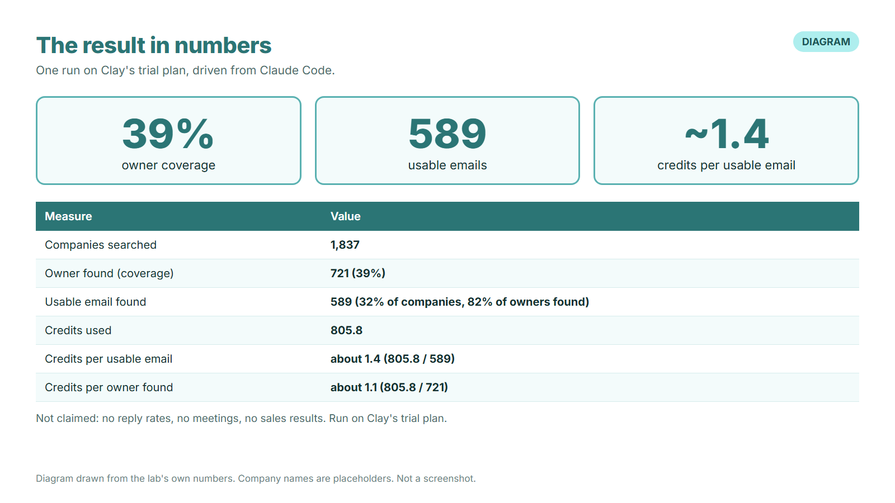
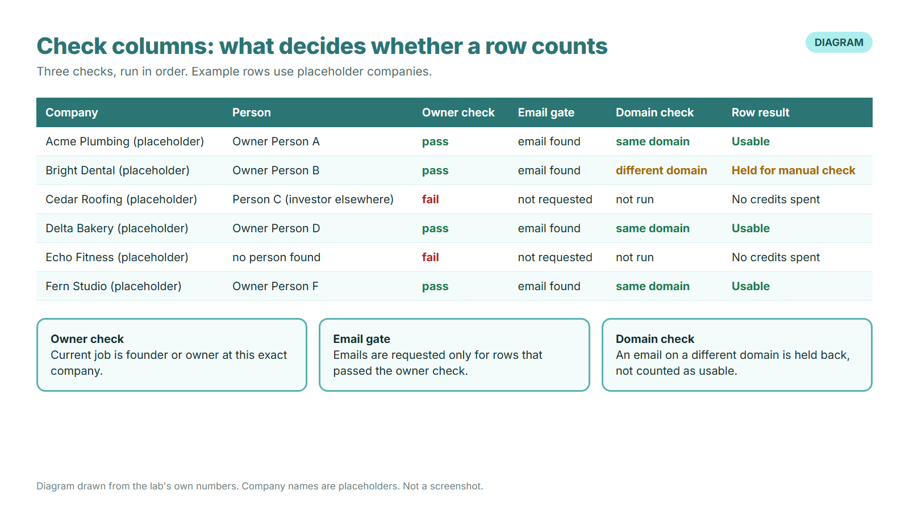
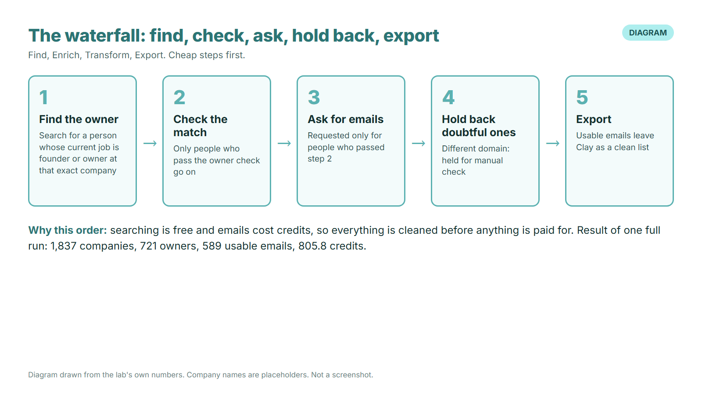
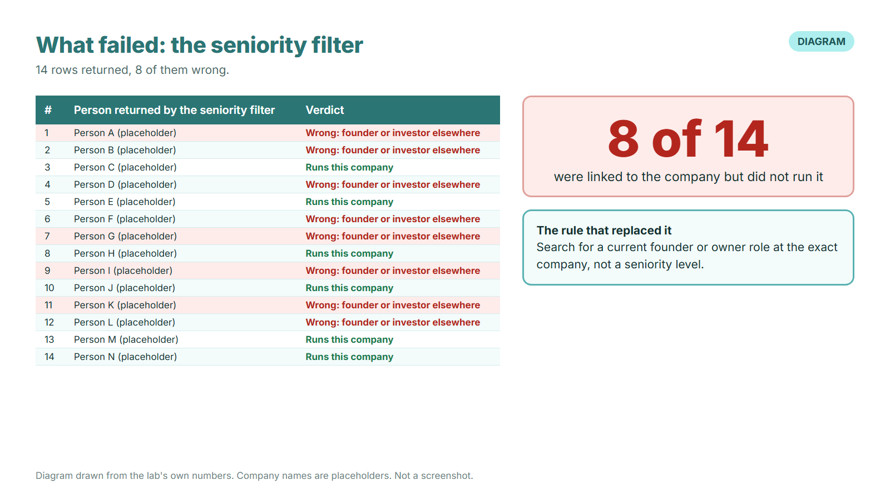
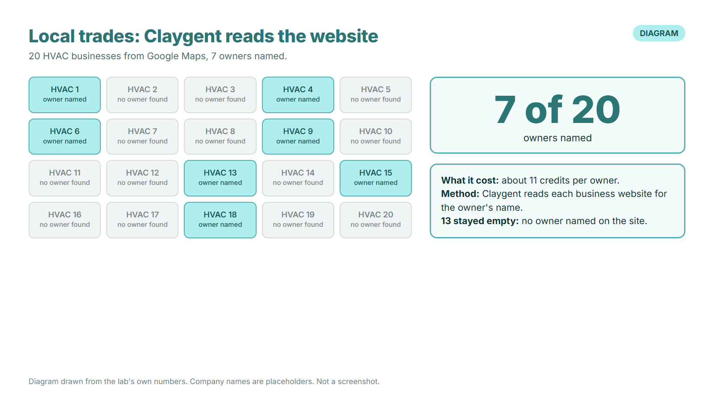

# growveloper-gtm-lab

How many named business owners can Clay, run from inside my Claude Code system, find across 1,837 companies, and at what credit cost per usable email? I ran it and wrote down what worked and what broke. The head-to-head against my own open-data chain is not run yet.

## Result in numbers

*Diagram, not a screenshot: the numbers table below, drawn for quick reading. Every value comes from the run log. The run used Clay's trial plan, and no reply rates, meetings or sales results are claimed.*

| Measure | Value |
|---|---|
| Companies searched | 1,837 |
| Owner found (coverage) | 721 (39%) |
| Usable email found (coverage) | 589 (32% of companies, 82% of owners found) |
| Credits used | 805.8 |
| Credits per usable email | about 1.4 (805.8 / 589) |
| Credits per owner found | about 1.1 (805.8 / 721) |
| Time per step | not logged in this run (see "What I would change") |

**Built with:** Clay, inside my own outbound system built in Claude Code. This run used Clay's trial plan.
**Not claimed:** no reply rates, no meetings, no sales results. This lab stops at a clean, checked list.

## 1. Problem

Only 5 of the 40 leads in my own lead bank were ready to send on 2 October 2026 (see `BASELINE.md`). The gap was not copy. It was knowing who owns the business and having an email I can trust for that person. This lab tests whether Clay's waterfall, driven from Claude Code, closes that gap, and what it costs in credits.

## 2. ICP and seed list

Who I want to reach: owners of small businesses, mostly 1 to 49 people, who might need web, marketing or automation work.

| Seed list | Companies | Why this list |
|---|---|---|
| My existing leads with no contact on file | 1,000 | The leads I already had and could not use |
| Companies hiring now for a marketing, growth or web role, 2 to 50 staff | 837 | A hiring post is a sign the company is investing in growth |

Input per company: company name and website only. A 20-company test set is kept private. No lead's personal data is committed to this repo.

## 3. The waterfall

Order: Find, Enrich, Transform, Export. Searching is free, emails cost credits, so everything is cleaned before anything is paid for.

1. **Find the owner.** The search asks for a person whose current job is founder or owner at that exact company, not a seniority level.
2. **Check the match.** Only people who pass the owner check go on.
3. **Ask for emails.** Requested only for people who passed step 2, so no credits go on the wrong person.
4. **Hold back doubtful ones.** An email on a different domain from the company is held for a manual check and not counted as usable.
5. **Export.** Usable emails leave Clay as a clean list.

| Source | Companies | Owner found | Owner coverage | Usable email | Email coverage (of owners) |
|---|---|---|---|---|---|
| My existing leads (no contact on file) | 1,000 | 272 | 27% | 232 | 85% |
| Hiring now, 2 to 50 staff | 837 | 449 | 54% | 357 | 80% |
| **Total** | **1,837** | **721** | **39%** | **589** | **82%** |

| Cost | Value |
|---|---|
| Credits used | 805.8 |
| Credits per email lookup | about 1 |
| Credits per usable email | about 1.4 |
| Local trades (HVAC, from Google Maps), website read by Claygent | 7 of 20 owners named, about 11 credits per owner |

## 4. Check columns

Three checks decide whether a row counts:

| Check | Rule | What it stops |
|---|---|---|
| Owner check | Current job is founder or owner at this exact company | Founders and investors elsewhere who are only linked to the company |
| Email gate | Emails are requested only for rows that passed the owner check | Credits spent on the wrong person |
| Domain check | An email on a different domain from the company is held for a manual check | Wrong-person or personal-address emails counted as usable |

*Diagram, not a screenshot. The rows are made-up placeholder companies; the three rules are the real ones. The owner check decides whether the person runs this exact company. The email gate means a row that fails it never costs an email credit (Cedar Roofing and Echo Fitness in the diagram). The domain check catches an email that sits on a different domain from the company: Bright Dental's row passed the owner check but is held for a manual check and not counted as usable.*

*Diagram, not a screenshot of the Clay setup screen. It shows the five steps in the order they run, and why: searching is free and emails cost credits, so the owner check comes first and an email is only requested for a row that passed it. That ordering is how the run reached 589 usable emails for 805.8 credits, about 1.4 per usable email.*

## 5. What failed, and the post-mortem

| What went wrong | What I did |
|---|---|
| The app's seniority filter alone returned the wrong people: 8 of 14 were founders or investors elsewhere, only linked to the company. | Searched for a current founder or owner role at the exact company instead of a seniority level. |
| 597 of my 1,000 existing leads returned nobody. Small local businesses are thin in people data. | For local trades, switched to Claygent reading each website: 7 of 20 owners found. |
| Clay's job table stopped at 50 rows on the trial plan, from 7,681 matching posts. | Noted it as a plan limit, not a method limit. |
| Clay's AI chat summary once listed owners against the wrong businesses, though the rows were right. | Trusted the rows, not the chat summary. |

**Post-mortem, short.** The biggest loss was the first idea: filtering by seniority. It looked right and returned people who had nothing to do with running the company. The fix was a rule about the exact company, and it is the reason the 589 can be trusted. The second loss was the 597 empty rows: for tiny local businesses, a people database is the wrong first source. A website is closer to the truth, at about 11 credits per owner.

*Diagram, not a screenshot. Names are placeholders; the counts are real. The seniority filter returned 14 people, and 8 of them were founders or investors elsewhere who were only linked to the company. They looked right because the title matched, but they did not run the business. The rule that replaced it asks for a current founder or owner role at the exact company.*

*Diagram, not a screenshot. Claygent was asked to read each business's website and name its owner. It named 7 of 20 at about 11 credits per owner. The other 13 stayed empty because no owner was named on the site, which fits the finding that small local businesses are thin in people data.*

## 6. What I would change

- Log time as well as credits: minutes per step, so I can report cost per usable email and time to a clean list.
- Run the same 20 test companies through my own open-data chain, so the head-to-head is real. Not run yet.
- For local trades, start with the website read and use the people database second.
- Add the credit log below to every run, so the numbers above are reproducible by anyone.

## 7. CRM activation: not built yet

This lab ends at a checked list. Nothing is pushed into a CRM or sent from here yet. The plan for it: send the usable emails into a free HubSpot account by CSV or API, with the fields mapped (owner name, company, email, source list, check results) and one trigger on a new record, then send through a real sending setup. I will add it here, with a screenshot, once it exists.

## To reproduce

1. Open a Clay account. This run used Clay's trial plan (805.8 credits used).
2. Add Clay to your Claude Code setup through Clay's connector.
3. Prepare the input: one row per company, with two columns, company name and website.
4. Ask for owners first, with the rule "current job is founder or owner at this exact company". Do not ask for emails yet.
5. Request emails only for the rows that passed step 4.
6. Hold back any email whose domain differs from the company's, and check those by hand.
7. Keep a credit log, one line per step, so you can work out credits per usable email:

| step | credits_before | credits_after | rows_passed |
|---|---|---|---|
| owner search | | | |
| email lookup | | | |
| domain check | | | |

## Notes

`BASELINE.md` holds the "before" counts for my lead bank (40 leads, 5 ready to send on 2026-10-02). Rows marked "to fill" were not measured yet.

Author: Obajuwon Oyekola (Juwon), [growveloper.com](https://growveloper.com)
