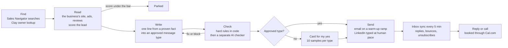

# My outbound system

My own outbound system, built in Claude Code with Clay inside it. It finds small businesses that are visibly paying for a
problem I fix, proves the problem from what it can see, writes one message per person, has a separate checker read every
message, and only then sends. It runs on my laptop every day, in my own Chrome, at human pace.

## Results so far (live since 31 Oct 2026)

| Measure | Value |
|---|---|
| Owners messaged | 593 |
| People who wrote back | 25 |
| Calls booked | 3 |
| Paying clients | 1 |

Counts come from the system's own database. Small numbers, early days: they show the system works end to end, not a
reply rate to plan around.

## The problem it solves

Cold outreach fails in two places: the wrong person (an inbox nobody reads, or someone who does not run the business) and
the wrong message (a template that could be about anyone). I wanted a system where every message is to a named owner,
about something true I can point to on their own site or ads, and nothing leaves without a second pair of eyes.

## How it works

1. **Find.** Saved Sales Navigator searches and lead lists, plus Clay for the owner and a verified email. Only a named
   person who runs the business goes on; a shared inbox (info@, office@) never does.
2. **Read.** The system reads each company's own site, its ads and its reviews, and scores the lead. A lead under the
   score bar is parked, never written to.
3. **Write.** One personal line written from a fact the system saw and saved, dropped into a message type I approved.
4. **Check.** Hard rules in code first (no price in a cold message, no claim the saved evidence does not prove, one
   approved proof line, consent by country), then a separate AI checker that did not write the message reads it as the
   owner would. A fault sends it back once; a second fault parks the company.
5. **Approve.** A new message type needs my yes on ten real samples. After that, messages of that type go without a
   tap; any change of angle, proof or wording voids the approval.
6. **Send.** Cold email only from separate warmed-up mailboxes on a daily ramp, inside the recipient's working hours,
   plain text, no open tracking. LinkedIn is typed in my own browser at human pace, one session at a time under a lock.
7. **Follow through.** A worker syncs the inbox every five minutes. A hard bounce pauses that mailbox. Replies, bookings
   and promises are tracked per conversation until a call is held.

## Guardrails (the part I care most about)

- **Locked text.** Every message is hashed when it passes the checker; approval is stored against that hash, and an
  edited message is a new message.
- **Consent by country.** Which channel is allowed depends on where the business is (sample: `code/consent.mjs`).
- **Warm-up ramp.** Cold mailboxes send 0, 4, 8, then 10 a day by week, never above a hard cap (`code/warmup.mjs`).
- **Lead gate.** No message to an unscored lead, a shared inbox, or anyone touched in the last 90 days
  (`code/leadgate.mjs`).
- **One pause switch** stops all sending at once, from the command line or by email.
- **Unattended runs only draft.** Code sends only what an approval allows.

## Stack

Claude Code (the windows that read, write and check), Node.js 22, SQLite (one file holds every lead, message and
conversation), Gmail API (sending and inbox sync), Clay, LinkedIn Sales Navigator, Chrome (read and typed at human pace),
Cal.com (bookings), Windows Task Scheduler. About 19,000 lines of code with its own test suite.

## What is in this folder

`code/` holds three modules from the system, unchanged, as samples of how the rules are written. The full system is
private: it holds real prospects' names, addresses and messages, and none of that belongs in a public repo.

## What I would change next

- Draft the nudge by itself when a warm conversation goes quiet past its due date (in progress).
- Wait longer for slow pages instead of stopping a reading run (in progress).
- Report reply and booking rates by message type and industry once the counts are big enough to mean something.

Author: Obajuwon Oyekola (Juwon), [growveloper.com](https://growveloper.com)
