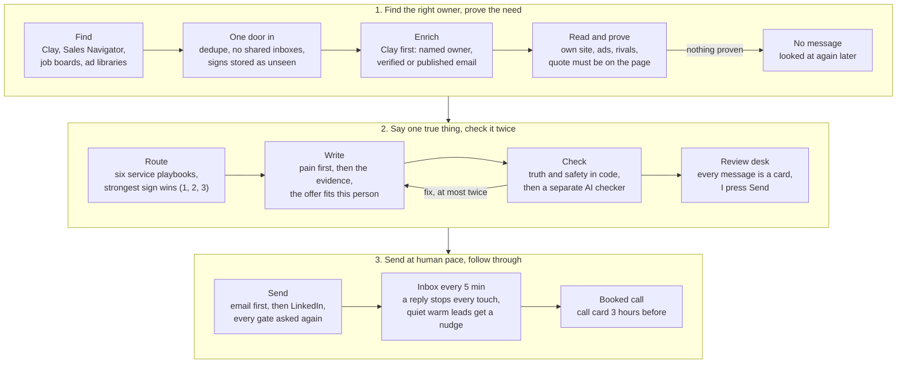

# My outbound system

> **Problem:** cold outreach goes to the wrong person with a message that could be about anyone.  
> **Build:** finds small businesses with a visible sign they need one of six services, proves the sign on their own page, writes one message from it, checks it twice, and puts every message on my review desk for my Send.  
> **Numbers:** 3 calls booked with different businesses, 2 proposals, 2 paying clients.  
> **What failed:** a week of zero drafts and zero errors: a score bar silently held 174 of 198 companies (fixed, and now watched daily).  
> **Next:** rates by message type and channel once 40 people stand behind each.  
> **Not built yet:** CRM sync.

My own outbound system, built in Claude Code with Clay inside it. AI decides what is worth saying; code decides whether it
is allowed to leave; I decide what actually goes. It runs on my laptop every day: one Claude Code window does the day's chain, a worker sends every five
minutes, and LinkedIn is read and typed in my own Chrome at human pace.

## Results so far (first message June 2026; current version since 31 Oct 2026)

| Measure | Value |
|---|---|
| Calls booked (different businesses) | 3 |
| Proposals sent | 2 |
| Paying clients | 2 |

Small numbers, early days: they show the system works end to end, not a rate to plan around. The rebuilt version is
measured by the date of each person's first message, and no rate is quoted until at least 40 people stand behind it.

## One lead, end to end (anonymised)

**Who:** the owner of a US medical practice, found in Sales Navigator.

**Why this business (two signals, both seen on its own site the day before the message):**
1. *Hiring:* the careers page was hiring a front-desk coordinator, so they pay a salary for someone to chase leads by hand.
2. *Page path:* the pricing page asked visitors to fill out a form before seeing any prices, so every price enquiry
   becomes a lead someone has to call back.

**The message it got (LinkedIn InMail; passed the code checks and the separate checker), with identifying details in
brackets:**

> Hi [first name], your [pricing page] asks people to fill out a form to see prices, and your careers page is hiring a
> [coordinator]. That usually means each price request waits for someone to follow it up by hand.
>
> I built an IT firm's automatic follow-up email sequences in Zoho.
>
> One idea: an instant reply to every pricing request with a consult link, and two follow-ups for anyone who doesn't book.
> Would that take some of the chasing off the new hire?
>
> Juwon

The two signals become the opening, one proof line from a real project backs it, and the offer fixes the exact problem the
signals point to. No price, no claim the evidence does not prove.

## The problem it solves

Cold outreach fails in two places: the wrong person (an inbox nobody reads, or someone who does not run the business) and
the wrong message (a template that could be about anyone). I wanted a system where every message is to a named owner,
about something true I can point to on their own site or ads, and nothing leaves without a second pair of eyes.

## How it works

**One Claude Code window runs the day.** Every morning a single lead-work window opens and does the whole chain in
order: Clay, the business pages in Chrome, routing, writing, checking, the review desk, and the LinkedIn sends I have
approved. It loops until nothing is left that does not wait on me, and closes at 23:30 Lagos, when the last US
recipients' working hours end. Anything that blocks it (a sign-in, a robot check, a question only I can answer) comes to
me at once as one question. Beside it, a worker with no AI runs every five minutes for the inbox, bookings and email sends.

1. **Find.** Clay company and people search, saved Sales Navigator searches and alerts, public job boards, funding news,
   and the Meta and Google ad libraries.
2. **One door in.** Every source goes through one intake step with the same rules: a known domain merges into its company,
   a shared inbox (info@, office@) is never a person, anyone touched in the last 90 days is held, and every sign enters as
   unseen until it is proven. Agencies are kept, and only offered a service they do not sell themselves.
3. **Enrich.** Clay is the main enrichment: one named owner per company and a work email. Only an address the business
   published, or one a finder verified, may ever get a cold email. A person Clay could not look up is left out, never
   written down as "not found".
4. **Read and prove.** The system reads the business's own site, its ads and up to three nearby rivals. A fact counts as
   seen only when its quote is found word for word in the page text, and a claimed problem needs two reads that agree.
   Recency is checked in code: an ad is called live only when its last-shown date can be read. Unproven, nothing reaches a
   message; the company is looked at again after its recheck date.
5. **Route.** Each company is read against all six services I sell (web build, SEO and AI visibility, ads, automation,
   growth engineering, GTM engineering). Each service has its own playbook, rebuilt on 14 Nov from deep research, with the
   signs that prove a need, the angles that fit, and the proof lines I approved word for word. A sign is rated 1, 2 or 3:
   a 3 is written first, a 2 is written, a 1 alone is only recorded. There is no score. Code refuses a route that skipped
   a service, picked a weaker sign, or quotes words not on the page.
6. **Write.** One message per person, pain first and then the evidence, in plain words: no dates and no source names.
   The writer decides the subject, whether a proof line belongs, and the offer, which is the
   next step for that person (a 30-minute look at the problem found, a demo or a draft), at most once per sequence. The
   free piece is made after a call is booked (one measured test aside). Greeting, opt-out and footer are code.
7. **Check.** Code guards truth and safety: no price, no claim the evidence does not prove, a real first name, one link,
   an opt-out, consent by country. Craft is learned, not hard-coded. Then a second AI that did not write the message reads
   it against the page and the evidence and gives a verdict. A fix goes back at most twice; then the company is set aside.
8. **Approve.** Every message, first touch, follow-up and close, is its own card on my review desk: who the company is,
   what they already got from me and when, why this one goes, and the date it was written. I press Send, edit or reject.
   My yes is stored against a fingerprint of the exact text: change one word and it is void.
9. **Send, in channel order.** For the strongest leads (a 3, up to 15 a week): email on day 1, a LinkedIn connection note
   naming the same finding 3 days later, a message once they accept, and an InMail 7 days after the note if they have not
   (open profiles first, their InMail is free). Everyone else gets the email sequence first, then a connection note 4 days
   after its last step. A person with no email starts on LinkedIn. LinkedIn runs on a weekly budget, typed in my own Chrome
   at human pace under a lock. Cold email goes only from separate warmed-up mailboxes, inside the recipient's working
   hours, plain text, no open tracking.
10. **Follow through.** A reply on any channel stops every live touch to that person. A bounce suppresses the address and
    pauses the mailbox. A sorter labels each reply; only simple ones (times, the booking link) are answered without me,
    and never anything about price or scope. A warm conversation that goes quiet gets a nudge on the channel we did not use
    last, as a card for my Send. A booked call gets a call card three hours before.

## Guardrails (the part I care most about)

- **Locked text.** Approval is stored against a fingerprint of the exact subject and body; an edited message is a new message.
- **Consent by country.** Which channel is allowed depends on where the business is (sample: `code/consent.mjs`).
- **Warm-up ramp.** Each new mailbox sends 0, 4, 8, then 10 cold emails a day by week, never above a hard cap (`code/warmup.mjs`).
- **Reply gate.** Nothing sends if the inbox has not been read cleanly in the last 15 minutes, or a reply is still unread.
- **No double sends.** A message is marked "sending" before the network call; an unclear error is never resent, it is
  matched against the Sent folder instead.
- **One pause switch** stops all sending at once, from the command line or by email.
- **Daily canary.** Every working morning, code checks that each stage (inbox read, signals, plays, exports, new leads)
  wrote something the day before. A stage that has quietly stopped is named in one email.

## Stack

Claude Code (one lead-work window a day reads, routes, writes and checks; a separate checker agent reviews), Node.js 22, SQLite (one file holds every lead, signal,
message and conversation, with triggers that refuse a send the rules forbid), Gmail API (sending and inbox sync), Clay,
LinkedIn Sales Navigator, Chrome (read and typed at human pace), Playwright (reading public pages), Cal.com (bookings),
Windows Task Scheduler. About 28,000 lines of code and 31,000 lines of tests.

## What is in this folder

`code/` holds two modules from the system as samples of how the rules are written. They import helpers that stay
private, so they are for reading, not for running. The full system is private: it holds real prospects' names,
addresses and messages, and none of that belongs in a public repo.

## What broke: the silent hold (9 November 2026)

The system wrote zero drafts for a week and logged zero errors. The cause was one number: a company with one proven fact
scored exactly 35, and the writers only started at 55, so 174 of 198 routed companies could never get a message. Nothing
broke; it quietly held. The review found nine causes of that kind (a step that ended the whole chain, a job stopped
before its batch finished, a day's lookups asked for all at once), and each was fixed in code. The score no longer
decides; the proven sign does. Then came the daily canary above, so a stage that goes quiet is noticed the next morning,
not a week later.

## What I would change next

- Rates by message type and channel, once at least 40 people stand behind each.
- Wait longer for slow pages instead of stopping a reading run (in progress).

Author: Obajuwon Oyekola (Juwon), [growveloper.com](https://growveloper.com)
